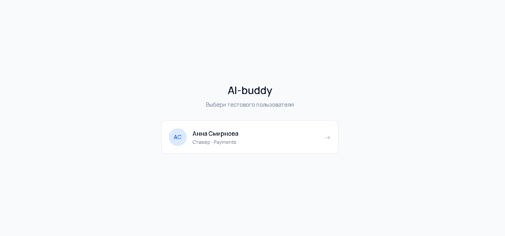
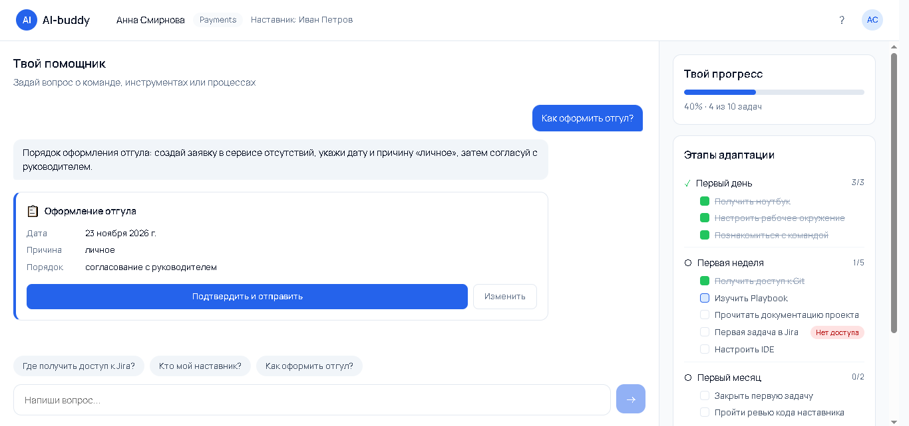

# AI-buddy — ИИ-наставник для стажёров

Прототип фронтенда для хакатона Hack&Change, кейс Авито. AI-buddy помогает стажёру освоиться в новой команде: отвечает на вопросы о процессах и инструментах, помогает найти ответственного, подготовить обращение и следить за прогрессом адаптации.

Это **прототип фронтенда на моках**. Представляет UX и сценарии, а не полное production-решение.

## Демо

- **Демо:** https://daryatash.github.io/ai-buddy-prototype/

- Страница авторизации

- Чат и чеклист

## Возможности

- **Имитация чата с ИИ-помощником.** Ответы на вопросы о команде, инструментах и процессах. Оптимистичное добавление сообщений, индикатор «печатает», обработка ошибок.
- **Карточка действия.** Если ответ требует действия (например, оформление отгула), бот прикрепляет карточку с полями и кнопками. Три состояния: `proposal` → `sending` → `result`. Поля можно редактировать.
- **Чек-лист адаптации.** Этапы, задачи, статусы (`done`, `in_progress`, `todo`, `blocked`) , следующий шаг.

## Сценарии демо

1. **Вход и знакомство.** Выберите тестового пользователя. Откроется чат с приветствием, справа — чек-лист с прогрессом.
2. **Вопрос про инструмент.** Спросите «Где получить доступ к Jira?». Бот ответит и подскажет, к кому обратиться.
3. **Карточка действия.** Спросите «Как оформить отгул?». Бот вернёт карточку. Нажмите «Изменить», поменяйте причину, «Сохранить», затем «Подтвердить» — карточка перейдёт в `result` с номером запроса.

## Стек

- **React 18** + **TypeScript** + **Vite**
- **Zustand** — состояние (`chatStore`, `authStore`)
- **TanStack Query** — запросы и кеш
- **Zod** — валидация ответов API
- **React Router** — роутинг (`/login`, `/chat`, `/team`, `/adaptation`)
- **MSW** — моки API в браузере и тестах
- **Vitest** + **React Testing Library** — тесты
- **CSS-модули** — стили, переменные в `index.css`